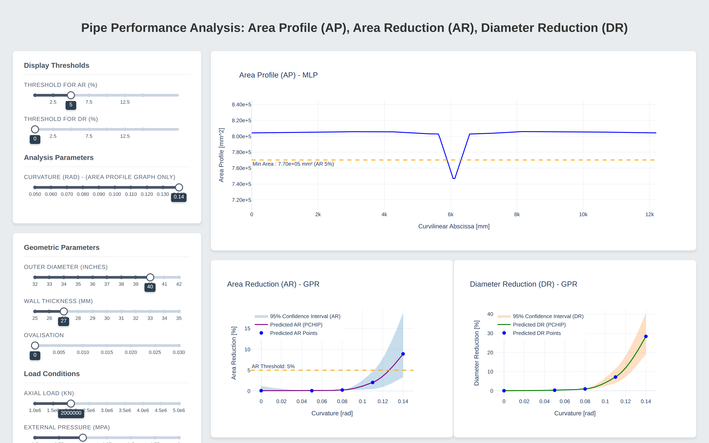
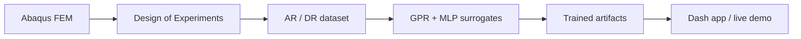

# Pipe Predictions

Interactive surrogate models for the cross-section response of steel pipes under bending and external pressure — the deployment layer of my [Master's thesis](https://github.com/fedetamburlin/Master-thesis).

[](https://pipe-analyzer.onrender.com/)
[](https://github.com/fedetamburlin/Master-thesis/blob/main/Tesi_Tamburlin.pdf)
[](LICENSE)



## The pipeline



The thesis repository contains the FEM model, the DoE and the training notebooks. This repository contains the trained artifacts and the web app that serves them.

## What it does

Predicts three quantities in milliseconds instead of running a full FE analysis:

- **AP** — area profile along the pipe axis (curve)
- **AR** — area reduction (%)
- **DR** — diameter reduction (%)

## Inputs and validity range

| Parameter | Range |
| --- | --- |
| Outer diameter (in) | 32–42 |
| Wall thickness (mm) | 25–35 |
| Axial load (N) | 1e6–5e6 |
| External pressure (MPa) | 0.5–2.0 |
| Young's modulus (MPa) | 190000–230000 |
| Yield stress SY1 (MPa) | 350–400 |
| Limit stress SY2 (MPa) | 450–500 |
| Equivalent plastic modulus EP2 | 0.1–0.2 |
| Initial ovalisation | 0–0.03 |

The curvature slider used by the area-profile plot is bounded by the range seen during training (loaded from `Models_APP/bounds_curv.joblib`).

## Models

- **GPR** (scikit-learn) for DR and AR — scalar outputs
- **MLP** (PyTorch, `128-128-64-32-1`) for the AP curve
- Input and output preprocessing with `StandardScaler`; all artifacts live in `Models_APP/`

## Provenance

The models were trained on a FEM dataset generated with Abaqus for my Master's thesis in Mathematical Engineering. Data generation, DoE and training code are in [Master-thesis](https://github.com/fedetamburlin/Master-thesis).

Included there: the Abaqus pipeline (`00`–`04`), the DoE, the post-processing notebooks (`05`–`08`) and `AR_DR_results.csv`. Not included: raw FEM outputs and the per-run profile CSVs, which are large and can be regenerated with the pipeline.

## Repository layout

| Path | Purpose |
| --- | --- |
| `main_app.py` | Dash app: layout, callbacks, model loading |
| `train_app.py` | Training script that produces `Models_APP/` from the thesis dataset |
| `Models_APP/` | Trained GPR/MLP models, scalers and plot parameters |
| `assets/style.css` | Dashboard styling |
| `Dockerfile`, `Procfile` | Deployment entry points |

## Run locally

```bash
python -m venv .venv && source .venv/bin/activate
pip install -r requirements.txt
python main_app.py   # http://127.0.0.1:8050
```

Tested with Python 3.12 and the pinned versions in `requirements.txt`.

## Deployment

The live demo runs on Render's free tier: the service sleeps after 15 minutes of inactivity, so the first request may take 30–60 s. Subsequent requests are immediate.

## Limitations

- Valid only inside the DoE range above — this is an interpolation model.
- Built on a thesis dataset; not intended for design certification.
- The training script expects the dataset produced by the thesis pipeline; it does not ship with the repository.

## License

MIT — see [LICENSE](LICENSE).
